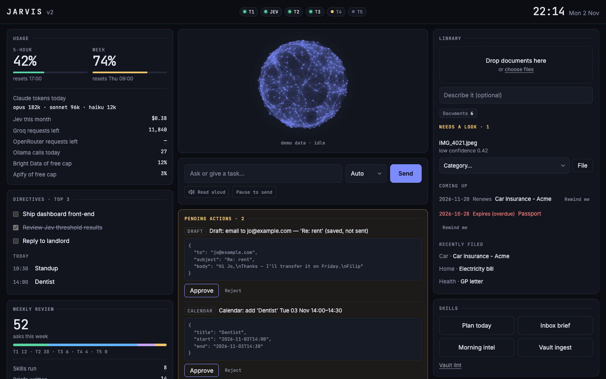
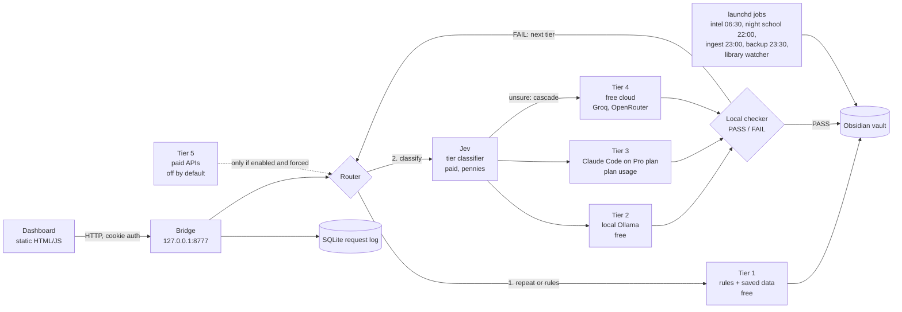
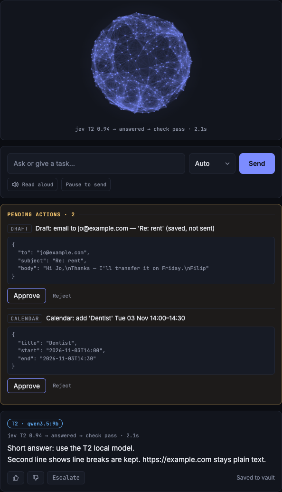
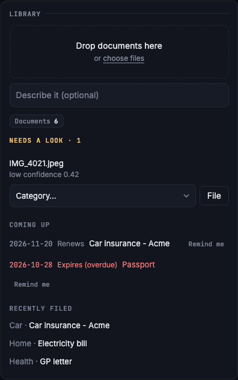

# Jarvis — a local-first personal AI operating system

One private assistant that runs on a single Mac: it answers from saved data or a local model first, calls cloud models only when it has to, and never acts on your behalf without an explicit Approve.



*Dashboard in demo mode. All data shown is made up.*

## The problem

My AI help was scattered across chat apps, paid APIs, notes and email. I wanted one assistant, on my own machine, that is cheap to run and safe to point at untrusted text such as emails and web pages.

## What it does

- **Dashboard**: an Ask box, usage meters, top-3 directives, inbox, morning intel, weekly review, system health and pending actions on one page.
- **Tiered routing**: each request goes to the cheapest tier that can answer it (see below). Every step is logged, with a thumbs up/down and an Escalate button that reruns one tier up.
- **Local answer checker**: a local model grades each answer `PASS` or `FAIL` before it is accepted, and a failure escalates to the next tier.
- **Document library**: drop a PDF or photo and it is read on-device (PDFKit text, Vision OCR for scans and images), classified by the local model, named, filed into the vault with a summary note, and checked for duplicates. A macOS notification says where each file went. Low-confidence documents wait in a review queue. Renewal and expiry dates feed a "coming up" list with a Remind me button.
- **Actions only after Approve**: Jarvis can propose a Notion task update, a calendar event or an email draft. Proposals are validated against a strict schema and wait for a click. Email is saved as a draft file with a mailto link; **it never sends email**.
- **Voice**: answers can be read aloud (browser speech synthesis, with a preferred voice from config). For input, any dictation app works with the "Pause to send" mode, which submits once the text has been still for 2.5 seconds.
- **Night school**: a nightly learning loop that reviews the day's routing decisions and proposes improvements (details below).
- **Vault backup and ingest**: scheduled jobs convert raw captures to wiki articles (23:00) and back up the Obsidian vault with local git (23:30).

## How it works



The ladder, as designed in [docs/ROUTING-DESIGN.md](docs/ROUTING-DESIGN.md):

| Tier | Who answers | Cost |
|---|---|---|
| 1 | No AI: rules and saved data (vault, digest) | free |
| Jev | Sorts each request to a tier and returns a confidence | paid, pennies |
| 2 | Local Ollama model | free |
| 3 | Claude Code on the Pro plan (`claude -p`) | plan usage |
| 4 | Free cloud: Groq, then OpenRouter | free |
| 5 | Paid APIs | off by default |

When the classifier is sure (confidence 0.9 or more) the request goes straight to that tier. When it is unsure, the default cascade is T2, then T4, then T3, with the local checker grading each answer. High-stakes wording (contract, payment, legal, medical, "send") skips the cascade and starts at T3. Private requests never go to third-party free clouds, and when the Pro plan is nearly used up, Tier 3 work spills to Tier 4.



*An answer with its route trail (classifier, tier, checker verdict, latency), two proposed actions waiting for Approve, and feedback buttons.*

## Engineering decisions

- **Standard library only.** The bridge is Python 3.13 with `http.server`, `sqlite3`, `urllib` and `subprocess`; the dashboard has no framework and no build step. No dependencies means nothing to patch and nothing to break on an update.
- **Cheap by construction.** Free and local tiers come first, Claude work runs on a flat-rate plan, and paid APIs are disabled by `paid_enabled: false` in `config.json`. Capped free tools (Bright Data, Apify) are tracked and stop being used at 80% of their free allowance.
- **Locked-down local server.** It binds to 127.0.0.1 only, issues an HttpOnly SameSite=Strict cookie that every `/api/*` call must present, rejects bad `Host` and `Origin` headers, sends a CSP with `frame-ancestors 'none'`, and keeps secrets only in a git-ignored `.env`.
- **Untrusted text can only propose.** Emails, web pages and RSS are fenced and summarised, never obeyed. Every headless `claude -p` call is restricted with an explicit `--tools` allowlist, `--strict-mcp-config` (no connectors) and `--permission-mode default` (nothing auto-approved). Anything model-generated that touches the outside world becomes a schema-validated proposal that executes at most once, and only after Approve.
- **Night school gates its own learning.** The teacher model (Opus, read-only tools) labels the right tier for the day's unsure, escalated and thumbs-down requests plus a random 10% of confident ones, which catches confident-but-wrong routing. It proposes one rulebook change, and promotes it only if it makes zero misses on every held-out split across at least three splits and agreement does not drop. Nothing applies without my approval, and there is a hard cap on cases and cost per run.
- **Measured, not assumed.** Before trusting a small local model as the answer checker I tested it (next section).
- **Failure is a value.** Providers never raise on network errors; they return `Answer(ok=False, error=...)`, so a missing key or a stopped service shows as a degraded tier on the dashboard instead of a crash.

## Results

- **Tests:** 187 unit tests, all passing with `AOS_OFFLINE=1` (no network).
- **Checker experiment:** 40 hand-written cases (20 good, 20 bad answers), run through the production checker prompt ([results](experiments/checker/RESULTS.md)).

| Checker model | Accuracy | Bad answers passed | Good answers rejected | Median latency |
|---|---|---|---|---|
| qwen3.5:9b | 100% | 0 of 20 | 0 of 20 | 5.7 s |
| qwen2.5:7b | 95% | 1 of 20 | 1 of 20 | 1.5 s |

  The small sample is a sanity check, not a benchmark. It is why the default checker is `qwen3.5:9b`.
- **Cost:** no paid API is called by default. The only paid service in the default path is the classifier (about $0.04 per million input tokens); Tier 5 requires both `paid_enabled: true` and an explicit force.

## Screenshots



*Document library: drop zone, a low-confidence file waiting for review, upcoming renewals and expiries, recently filed documents.*

## Running it

This is a personal project built for one Mac, not a packaged product. Setup assumes my layout.

Requirements: macOS 14+, Python 3.13, [Ollama](https://ollama.com) with the model named in `config.json` (`qwen3.5:9b`, fallback `qwen2.5:7b`). Optional: Obsidian with the Local REST API plugin, the `claude` CLI, and free Groq/OpenRouter keys.

```bash
git clone https://github.com/phillthereal/jarvis ~/agentic-os   # scripts and launchd jobs expect this path
cd ~/agentic-os
cp .env.example .env              # every key is optional; missing ones switch that feature off
AOS_OFFLINE=1 python3 -m unittest # full suite, no network
python3 -m bridge                 # then open http://127.0.0.1:8777
```

**Demo mode** needs no bridge. `web/` is static, so `python3 -m http.server 8799 -d web` and `http://127.0.0.1:8799/index.html?demo=1` shows the dashboard with built-in sample data (this is how the screenshots were taken).

Routing reuses the `router` package (classifier client and rulebook) from the companion repo [ai-workload-router](https://github.com/phillthereal/ai-workload-router). Clone it and point `AOS_AI_WORKLOAD` at it.

## How it was built

Designed and directed by me, implemented with AI pair-programming (Claude Code) using an orchestrator and worker flow: one session plans and reviews, worker sessions implement. Every change was reviewed and tested before it was kept.

## Related

- [ai-workload-router](https://github.com/phillthereal/ai-workload-router): the routing and classifier project that Jarvis builds on.
